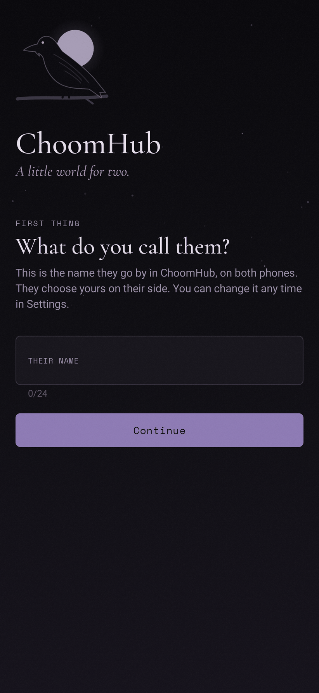
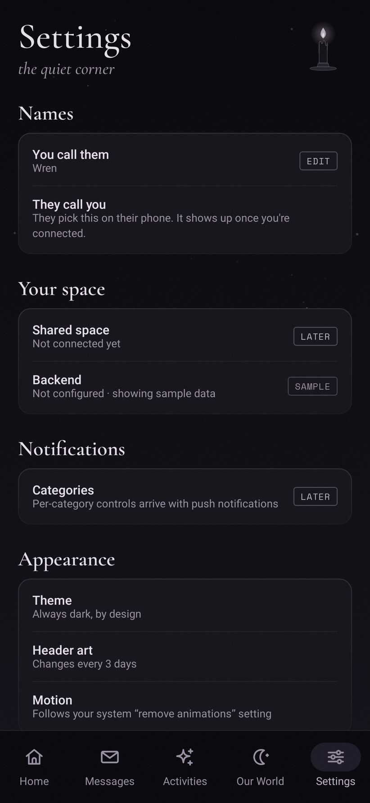
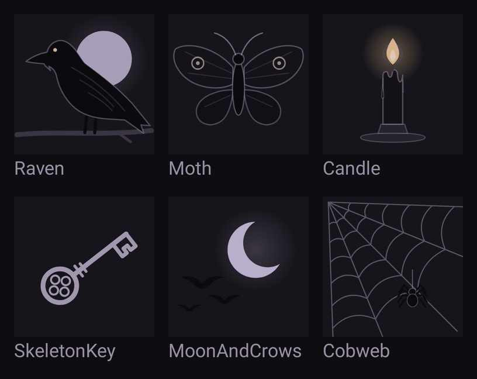

# ChoomHub

*A little world for two.*

ChoomHub is a private Android app for exactly two people: a small, dark, quiet shared space for
moods, snaps, letters, gestures, playful points, a shared black cat and a fair number of tomatoes
and crows. It is not a social network: no public profiles, feeds, ads or monetisation.

<p align="center">
  
  
  
  
</p>

<sub>Screenshots are rendered on the JVM by `ScreenshotCaptureTest` / `MotifGalleryCaptureTest`
(Robolectric), not taken on a device.</sub>

## Product vision

Gloomy and alternative rather than cute: rain, ravens and crows, moths and candles, polaroids,
old-book serif type with a typewriter edge, dusty violet and faded rose on near-black. Warm without
being sugary. The full feature roadmap lives in [docs/ROADMAP.md](docs/ROADMAP.md).

## Current status

What exists **today**:

- A buildable single-module Android project (`com.choomhub.app`).
- A custom dark design system: muted palette, Cormorant Garamond + Space Mono (bundled, OFL),
  film grain, line-art gesture icons, and hand-drawn Canvas illustrations: a set of six gothic
  header motifs that rotate every three days, crows on a wire, the shared cat watching a crow
  through a rainy window, a sealed letter, tarot cards, polaroids.
- **Sign-in and pairing** (with Firebase configured): Google sign-in, then one of you starts a
  space and the other joins with a single-use, 48-hour invite code. At most two people.
- **Naming**: you name your partner; they name you. Synced through Firestore; editable in Settings.
- **Meetup countdown** at the top of Home: live days/hrs/min/sec with a moon face that goes from
  teary (nothing planned) to sad, happy and excited as the day gets closer. Synced between phones.
- A **home screen** with your partner's real name and **sample** mood, latest snap, gesture
  buttons, Good Boy / Good Girl points and the shared cat, clearly labelled as sample data.
- Bottom navigation between Home, Messages, Activities, Our World and Settings. Non-home tabs are
  honest "coming soon" screens.
- Unit tests plus Robolectric UI tests (onboarding, renaming, navigation, screenshot capture).

What does **not** exist yet: real moods, snaps, messages, points, notifications or widgets. The
gesture buttons say so when tapped. Without Firebase config the app runs in device-only mode.

## Technology stack

| Area | Choice | In use now? |
|---|---|---|
| Language / UI | Kotlin, Jetpack Compose, Material 3 (heavily customised) | Yes |
| Architecture | MVVM + Clean Architecture layering, feature packages | Yes |
| DI | Hilt (KSP) | Yes |
| Navigation | Navigation Compose with type-safe `@Serializable` routes | Yes |
| Preferences | DataStore (Preferences) | Yes (device-only mode) |
| Build | Gradle Kotlin DSL, version catalog, AGP 9 built-in Kotlin | Yes |
| Offline / sync | Firestore on-device cache + queued writes | Yes |
| Background | WorkManager | Planned (fallback sync) |
| Images / widgets | Coil, Jetpack Glance | Planned |
| Backend | Firebase, free Spark plan: Authentication (Google), Cloud Firestore + security rules | Yes |
| Push | Firebase Cloud Messaging, sent by a free Cloudflare Worker | Planned |

Exact versions are in [`gradle/libs.versions.toml`](gradle/libs.versions.toml). Only libraries the
code actually uses are declared; the planned ones are added in the milestone that needs them.

SDK levels: min 26 (Android 8.0), target 36, compile 37.2.

## Development requirements

- **Android Studio**: a recent stable release that supports **Android Gradle Plugin 9.5**. If
  Gradle sync reports that the AGP version is unsupported, update Android Studio.
- **JDK 17 or newer** for Gradle (Android Studio's bundled JDK works).
- **Android SDK Platform 37.2** (Studio will offer to install it on first sync).
- An Android phone or emulator running Android 8.0+.

## Build and run

From Android Studio: open the project folder, let Gradle sync, choose the `app` run configuration
and press Run.

From a terminal:

```bash
# Windows: use gradlew.bat instead of ./gradlew
./gradlew assembleDebug          # builds app/build/outputs/apk/debug/app-debug.apk
./gradlew installDebug           # installs on a connected device
./gradlew testDebugUnitTest      # unit + Robolectric UI tests
./gradlew lintDebug              # Android lint
```

After `testDebugUnitTest`, rendered screenshots of every screen (and the motif gallery) are
written to `app/build/outputs/screenshots/`.

Backend config goes in your git-ignored `local.properties` (four Firebase values; see
[docs/ARCHITECTURE.md § Configuration](docs/ARCHITECTURE.md#9-configuration)). Without it the app
builds and runs in device-only mode. Firestore security rules live in `firebase/firestore.rules`;
test them with `cd firebase && npm install && npm run test:rules` (needs Java).

Everything is designed to stay on free tiers with no card on file (see ADR-020).

## Documentation

- [docs/ARCHITECTURE.md](docs/ARCHITECTURE.md): layers, offline-first plan, sync, notifications,
  security, widget.
- [docs/ROADMAP.md](docs/ROADMAP.md): milestones and status.
- [docs/DECISIONS.md](docs/DECISIONS.md): architectural decision log.

## Licences

Bundled fonts: Cormorant Garamond and Space Mono, both under the SIL Open Font License 1.1
(texts in `app/src/main/assets/licenses/`).
