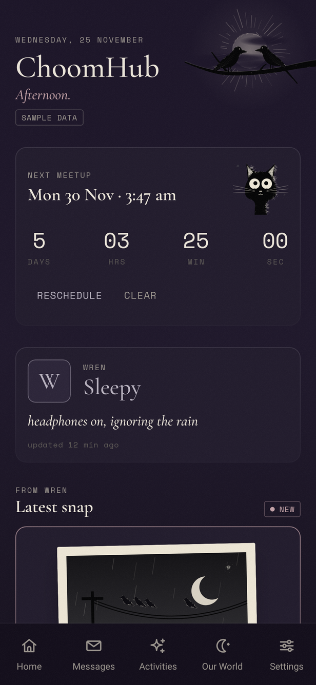
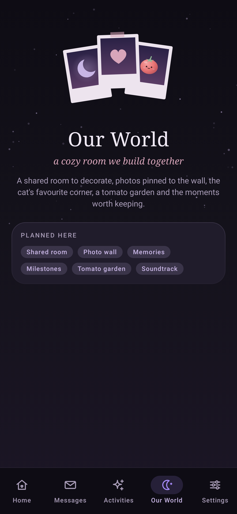

# ChoomHub

*A little world for two.*

ChoomHub is a private Android app for exactly two people: a small,
cozy, slightly gloomy shared space for moods, snaps, letters, affection, playful points, a shared
black cat and a lot of tomatoes. It is not a social network: no public profiles, feeds, ads or
monetisation.

<p align="center">
  
  
  
</p>

<sub>Screenshots are rendered on the JVM by `ScreenshotCaptureTest` (Robolectric), not taken on a device.</sub>

## Product vision

Rainy nights, black cats, purple and muted-pink light, polaroids and handwritten letters, cute
tomatoes. The interface should feel intimate and a little magical while staying readable and calm.
The full feature roadmap lives in [docs/ROADMAP.md](docs/ROADMAP.md).

## Current status: Milestone 1 (foundation and visual prototype)

What exists **today**:

- A buildable single-module Android project (`com.choomhub.app`).
- A custom dark design system: palette, typography, shapes, spacing, cards, buttons, badges,
  hand-drawn Canvas illustrations (moon, sparkles, tomato, black cat, rainy window, love letter,
  polaroids) and custom navigation icons.
- A polished **home screen** driven by **local sample data** (clearly labelled as such):
  partner mood, latest snap, affection buttons, Good Boy / Good Girl points, shared-cat teaser.
- Bottom navigation between Home, Messages, Activities, Our World and Settings. The non-home
  tabs are honest "coming soon" screens; Settings shows the real configuration status.
- Unit tests plus Robolectric UI tests that launch the app and walk every tab.

What does **not** exist yet: login, Supabase, Room, sync, notifications, widgets, or any feature
that actually sends something. The affection buttons say so when tapped.

## Technology stack

| Area | Choice | In use now? |
|---|---|---|
| Language / UI | Kotlin, Jetpack Compose, Material 3 (heavily customised) | Yes |
| Architecture | MVVM + Clean Architecture layering, feature packages | Yes |
| DI | Hilt (KSP) | Yes |
| Navigation | Navigation Compose with type-safe `@Serializable` routes | Yes |
| Build | Gradle Kotlin DSL, version catalog, AGP 9 built-in Kotlin | Yes |
| Local DB / prefs / background | Room, DataStore, WorkManager | Planned |
| Images / widgets | Coil, Jetpack Glance | Planned |
| Backend | Supabase (Auth, Postgres + RLS, Storage, Realtime, Edge Functions) via supabase-kt | Planned |
| Push | Firebase Cloud Messaging (HTTP v1, sent from an Edge Function) | Planned |

Exact versions are in [`gradle/libs.versions.toml`](gradle/libs.versions.toml). Only libraries the
code actually uses are declared; the planned ones are added in the milestone that needs them.

SDK levels: min 26 (Android 8.0), target 36, compile 37.2.

## Development requirements

- **Android Studio**: a recent stable release that supports **Android Gradle Plugin 9.5**. If
  Gradle sync reports that the AGP version is unsupported, update Android Studio.
- **JDK 17 or newer** for Gradle (Android Studio's bundled JDK works).
- **Android SDK Platform 37.2** (Studio will offer to install it on first sync).
- An Android phone or emulator running Android 8.0+.

## Build and run

From Android Studio: open the project folder, let Gradle sync, choose the `app` run configuration
and press Run.

From a terminal:

```bash
# Windows: use gradlew.bat instead of ./gradlew
./gradlew assembleDebug          # builds app/build/outputs/apk/debug/app-debug.apk
./gradlew installDebug           # installs on a connected device
./gradlew testDebugUnitTest      # unit + Robolectric UI tests
./gradlew lintDebug              # Android lint
```

After `testDebugUnitTest`, rendered screenshots of every tab are written to
`app/build/outputs/screenshots/`.

No backend credentials are needed for this milestone. See
[docs/ARCHITECTURE.md § Configuration](docs/ARCHITECTURE.md#configuration) for how they will be
supplied later.

## Documentation

- [docs/ARCHITECTURE.md](docs/ARCHITECTURE.md): layers, offline-first plan, sync, notifications,
  security, widget.
- [docs/ROADMAP.md](docs/ROADMAP.md): milestones and status.
- [docs/DECISIONS.md](docs/DECISIONS.md): architectural decision log.

## Planned feature roadmap (summary)

Moods and check-ins · affection gestures · snaps with a home-screen widget · messages, voice notes
and letters · productivity achievements and a ledger-based points system · shared cat · tomato
universe · shared room, memories, daily questions and mini-games. Details and order in
[docs/ROADMAP.md](docs/ROADMAP.md).
